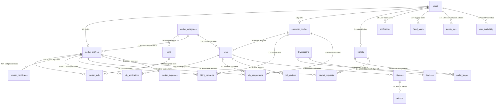

# WorkPay AI — Database Design & Data Dictionary

**Database Name:** `workpay_ai`  
**Storage Engine:** InnoDB  
**Default Character Set:** `utf8mb4`  
**Collation:** `utf8mb4_unicode_ci`  

---

## 1. Relational Entity-Relationship (ER) Overview

---

## 2. Comprehensive Schema Data Dictionary

### Core Tables

#### 1. `users`
Central identity registry for all platform actors.
- `id` INT UNSIGNED AUTO_INCREMENT PRIMARY KEY
- `email` VARCHAR(191) NOT NULL UNIQUE
- `password_hash` VARCHAR(255) NOT NULL (Bcrypt, salt rounds 10)
- `role` ENUM('customer', 'worker', 'admin') NOT NULL
- `full_name` VARCHAR(150) NOT NULL
- `phone` VARCHAR(20) NOT NULL (Index)
- `avatar_url` VARCHAR(255) DEFAULT NULL
- `is_verified` BOOLEAN NOT NULL DEFAULT FALSE
- `is_active` BOOLEAN NOT NULL DEFAULT TRUE
- `created_at` / `updated_at` TIMESTAMP

#### 2. `worker_categories`
Trade classifications and benchmark wage ranges.
- `id` INT UNSIGNED AUTO_INCREMENT PRIMARY KEY
- `name` VARCHAR(100) NOT NULL UNIQUE
- `slug` VARCHAR(100) NOT NULL UNIQUE
- `description` TEXT
- `icon` VARCHAR(50) DEFAULT 'Wrench'
- `min_hourly_rate` DECIMAL(10,2) NOT NULL DEFAULT 150.00
- `max_hourly_rate` DECIMAL(10,2) NOT NULL DEFAULT 1000.00
- `base_daily_rate` DECIMAL(10,2) NOT NULL DEFAULT 800.00

#### 3. `worker_profiles`
Trade specialization, verified credentials, ratings, and salary preferences.
- `id` INT UNSIGNED AUTO_INCREMENT PRIMARY KEY
- `user_id` INT UNSIGNED NOT NULL UNIQUE (FK -> `users.id` ON DELETE CASCADE)
- `category_id` INT UNSIGNED DEFAULT NULL (FK -> `worker_categories.id`)
- `bio` TEXT
- `address` VARCHAR(255) DEFAULT NULL
- `preferred_location` VARCHAR(150) DEFAULT NULL (Index)
- `experience_years` DECIMAL(4,1) NOT NULL DEFAULT 1.0 (Index)
- `education` VARCHAR(150) DEFAULT NULL
- `languages` VARCHAR(255) DEFAULT 'English, Hindi, Kannada'
- `expected_salary` DECIMAL(10,2) NOT NULL DEFAULT 500.00 (Index)
- `payment_preference` ENUM('per_job', 'daily', 'weekly', 'monthly', 'hourly') NOT NULL
- `availability_status` ENUM('available', 'busy', 'unavailable') NOT NULL (Index)
- `rating_avg` DECIMAL(3,2) NOT NULL DEFAULT 5.00 (Index)
- `rating_count` INT UNSIGNED NOT NULL DEFAULT 0
- `total_completed_jobs` INT UNSIGNED NOT NULL DEFAULT 0
- `profile_completion` INT UNSIGNED NOT NULL DEFAULT 40
- `verification_status` ENUM('pending', 'verified', 'rejected') NOT NULL DEFAULT 'pending' (Index)

#### 4. `customer_profiles`
Hiring history and dispatch address for clients.
- `id` INT UNSIGNED AUTO_INCREMENT PRIMARY KEY
- `user_id` INT UNSIGNED NOT NULL UNIQUE (FK -> `users.id` ON DELETE CASCADE)
- `address` VARCHAR(255) DEFAULT NULL
- `preferred_location` VARCHAR(150) DEFAULT NULL
- `total_jobs_posted` INT UNSIGNED NOT NULL DEFAULT 0
- `total_hired` INT UNSIGNED NOT NULL DEFAULT 0

#### 5. `skills` & `worker_skills`
Normalized many-to-many junction mapping trade proficiencies.
- Unique key: `uk_worker_skill (worker_id, skill_id)`
- Stores `years_experience` and `proficiency_level` ('beginner', 'intermediate', 'expert').

#### 6. `worker_certificates`
Audited vocational credentials and diplomas.
- `verification_status` ENUM('pending', 'verified', 'rejected')
- Admin notes and issuing authority audit records.

---

### Job Management Tables

#### 7. `jobs`
Customer requirements with comprehensive specifications.
- `id` INT UNSIGNED AUTO_INCREMENT PRIMARY KEY
- `customer_id` INT UNSIGNED NOT NULL (FK -> `customer_profiles.id`)
- `category_id` INT UNSIGNED NOT NULL (FK -> `worker_categories.id`)
- `title` VARCHAR(200) NOT NULL
- `description` TEXT NOT NULL
- `required_skills` VARCHAR(255) DEFAULT NULL
- `required_experience` DECIMAL(4,1) DEFAULT 1.0
- `location` VARCHAR(150) NOT NULL (Index)
- `budget` DECIMAL(10,2) NOT NULL (Index)
- `payment_type` ENUM('per_job', 'daily', 'weekly', 'monthly', 'hourly') NOT NULL
- `status` ENUM('open', 'applications_received', 'hiring_pending', 'accepted', 'in_progress', 'completed', 'cancelled', 'disputed') NOT NULL DEFAULT 'open' (Index)

#### 8. `job_applications`
Worker proposals with competitive bids.
- Unique constraint: `uk_job_worker_application (job_id, worker_id)`
- Stores `proposed_rate`, `proposal_text`, and `status`.

#### 9. `hiring_requests`
Direct job offers dispatched by customers to specific workers.
- Stores `offered_rate`, `payment_type`, and `status` ('pending', 'accepted', 'rejected', 'cancelled').

#### 10. `job_assignments`
Execution contracts tracking dual completion sign-offs.
- `worker_confirmed_completion` BOOLEAN DEFAULT FALSE
- `customer_confirmed_completion` BOOLEAN DEFAULT FALSE
- `status` ENUM('active', 'worker_completed', 'fully_completed', 'disputed', 'cancelled')

#### 11. `job_reviews`
Bi-directional customer and worker performance feedback.
- `reviewer_id` / `reviewee_id`
- `rating` DECIMAL(2,1)
- `sentiment` ENUM('positive', 'neutral', 'negative')

---

### FinTech & Wallet Tables

#### 12. `wallets`
Worker internal earnings balance ledger.
- `available_balance` DECIMAL(12,2) NOT NULL DEFAULT 0.00
- `pending_balance` DECIMAL(12,2) NOT NULL DEFAULT 0.00
- `total_lifetime_earnings` DECIMAL(12,2) NOT NULL DEFAULT 0.00
- `currency` VARCHAR(3) DEFAULT 'INR'

#### 13. `transactions`
Audited digital transactions via payment gateway.
- `transaction_reference` VARCHAR(64) NOT NULL UNIQUE
- `gateway_order_id`, `gateway_payment_id`, `gateway_signature`
- `platform_fee` DECIMAL(10,2) NOT NULL DEFAULT 0.00 (5% platform revenue)
- `net_amount` DECIMAL(12,2) NOT NULL (Worker credit)
- `idempotency_key` VARCHAR(100) UNIQUE (Guarantees zero duplicate credits)

#### 14. `wallet_ledger`
Double-entry immutable financial ledger.
- `entry_type` ENUM('credit', 'debit')
- `category` ENUM('job_payment', 'payout', 'platform_fee', 'refund', 'expense')
- `amount` DECIMAL(12,2) NOT NULL
- `balance_after` DECIMAL(12,2) NOT NULL
- `description` VARCHAR(255) NOT NULL

#### 15. `invoices`
Tax invoice records linked to completed transactions.
- `invoice_number` VARCHAR(50) NOT NULL UNIQUE (Format: `INV-YYYY-XXXXX`)
- Itemized tax breakdown and downloadable PDF metadata.

#### 16. `payout_requests`
Worker withdrawal tracking.
- `amount` DECIMAL(12,2)
- `payment_method` ENUM('bank_transfer', 'upi')
- `account_details` TEXT
- `status` ENUM('pending', 'approved', 'processing', 'completed', 'rejected')
- Automatic refund logic upon rejection.

#### 17. `disputes` & `refunds`
Mediation records for client complaints and automated refund processing.

#### 18. `worker_expenses`
Self-logged trade overheads (tools, transit, consumables).

---

### AI & Administration Tables

#### 19. `fraud_alerts`
Heuristic & AI anomaly detection alerts.
- `risk_score` INT UNSIGNED (0 to 100)
- `alert_type` (e.g. 'High Transaction Velocity', 'Abnormal Job Cancellation Ratio')
- `severity` ENUM('low', 'medium', 'high', 'critical')
- `status` ENUM('new', 'under_review', 'dismissed', 'action_taken')

#### 20. `chatbot_conversations` & `chatbot_messages`
Multilingual conversational session transcripts with detected intent and language tags ('en', 'kn', 'hi').

#### 21. `admin_logs`
Full administrator audit trail capturing actions, targets, details, and IP addresses.

#### 22. `user_availability`
Weekly shift schedule per user (Monday through Sunday) with start/end time windows.

